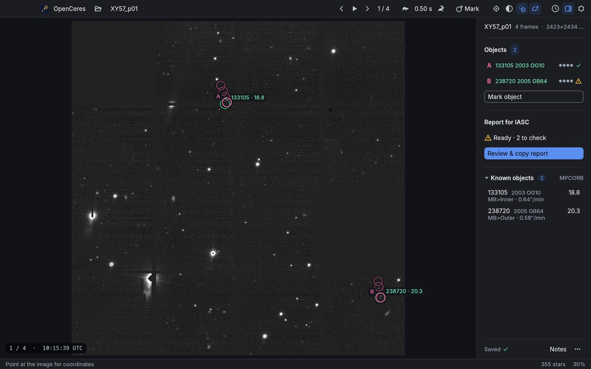
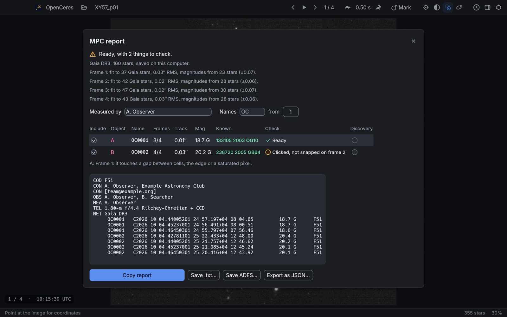

<div align="center">


# OpenCeres

**A small, fast, open-source app for asteroid searching.**
Blink your survey images, spot what moves, check known asteroids and comets, and copy an MPC report.

[](https://github.com/alidevecioglu/OpenCeres/releases/latest)
[](https://github.com/alidevecioglu/OpenCeres/actions/workflows/build.yml)
[](#license)


[**Download**](https://alidevecioglu.github.io/OpenCeres/) ·
[Releases](https://github.com/alidevecioglu/OpenCeres/releases) ·
[Report a problem](https://github.com/alidevecioglu/OpenCeres/issues)



</div>

OpenCeres is built for amateur search teams taking part in campaigns such as
those of the [International Astronomical Search Collaboration (IASC)](https://iasc.cosmosearch.org/),
where students and amateur astronomers blink sets of Pan-STARRS images to
discover new asteroids and report them to the
[Minor Planet Center](https://minorplanetcenter.net/).
It is named after Ceres, the first asteroid ever found (Piazzi, 1801).

> [!NOTE]
> **In trial.** Blinking, known objects and comets, and full MPC reports with
> positions measured against Gaia DR3 work today. On real IASC Pan-STARRS
> images the plate solutions fit to 0.02–0.03″ and known asteroids land within
> 0.15″ of their predicted places. Campaigns have not yet confirmed that
> they accept the reports, so run OpenCeres alongside your current software
> until they do. Automatic moving-object detection is not built yet.

## Features

- **Blink** — open a folder of FITS images or the `.zip` you were sent; frames
  load in parallel and blink at any speed from 0.1 to 5 s per frame (drag,
  scroll, presets or keys), with stretch, invert, zoom and alignment on the
  stars.
- **Mark what moves** — click a moving object on each frame; marks snap to
  the detected source and the next position is predicted for you.
- **Known objects and comets** — asteroids and comets already in the field are
  circled with their name, magnitude and motion, from the MPC's MPCORB and
  comet catalogues on your own computer (works offline) or online with
  [SkyBoT](https://ssp.imcce.fr/webservices/skybot/).
- **MPC report** — every mark is measured against Gaia DR3 stars in the same
  frame: plate solution, centroid, magnitude and uncertainty. Review the
  report, then **Copy report** and paste it into your campaign's report box.
  The MPC header comes from your team details; Save as `.txt` or as ADES PSV.
  Positions taken only from the image header are never offered for copying.
  Gaia stars come from VizieR, trying its mirrors in turn, and are kept for
  offline use.
- **Search history** — every search is saved as you work: who measured it,
  the marked objects, notes and its status as it moves through the campaign's
  steps (reported → preliminary detection → provisional designation →
  numbered). Reopen a set to continue where you left off. Point the history at
  a shared folder (OneDrive, Google Drive, a network drive) to collect a whole
  team's searches, or export and import them as JSON.
- **Welcome and languages** — a short welcome on first launch sets the
  language, theme, team details and catalogue. The interface is ready for
  translation: see [TRANSLATING.md](TRANSLATING.md) to add your language.
- **Box report (optional)** — the older grid report (click the boxes where
  something moves) is still there under Settings → Features.
- **Tiny and fast** — native Rust with no web engine: about 5 MB, starts
  instantly and uses ~0 % CPU when idle. The core library has no third-party
  dependencies.
- **Everywhere** — Apple Silicon and Intel Macs (with a native menu bar),
  Windows and Linux. No Wine, no emulators.
- **Keeps itself current** — checks for new versions and catalogue updates.

<p align="center">
  
</p>

## Download

Get the latest version from the **[download page](https://alidevecioglu.github.io/OpenCeres/)**
or the [releases page](https://github.com/alidevecioglu/OpenCeres/releases/latest).

| Platform | File | First launch |
| --- | --- | --- |
| macOS 11+ (Apple Silicon and Intel) | `OpenCeres-<version>-macos.dmg` | Drag to Applications, then right-click OpenCeres → **Open** (the app is not yet notarised by Apple). |
| Windows 10 / 11 (64-bit) | `OpenCeres-<version>-windows-x86_64.zip` | Unzip and run `OpenCeres.exe`. If SmartScreen warns you, choose **More info → Run anyway**. |
| Linux (x86_64) | `OpenCeres-<version>-linux-x86_64.tar.gz` | Extract and run `./openceres-desktop` (needs OpenGL). |

Each download also contains `openceres`, a command-line tool for inspecting
FITS files, listing detected stars and plate-solving a frame against Gaia.

## Goals

- **Accurate.** Positions must match established software on the same images
  before anyone relies on them.
- **Tiny and fast.** A few megabytes, native, using every CPU core.
- **Easy to use.** Drop an image set in and get candidates; confirm with the
  keyboard; one click to a ready-to-send report. No configuration files.
- **Open.** Free to use, study and improve.

## Layout

```
crates/core     openceres-core: FITS, detection, WCS, plate solving against Gaia,
                photometry, orbits and ephemerides, MPC and ADES formats (no dependencies)
crates/cli      openceres: command-line tool for checking the core on real data
crates/desktop  OpenCeres desktop app: egui (pure Rust, OpenGL), no web engine;
                interface texts in crates/desktop/locales/
docs/           download page (GitHub Pages)
```

## Building

Everything builds inside Docker; nothing needs to be installed on your machine
except Docker itself.

```sh
./dev check                      # core + CLI: format check, clippy, tests
./dev cargo test                 # tests only
./dev cargo build --release      # release build (Linux, in the container)
./dev shell                      # shell inside the dev container
```

Command-line tool:

```sh
./dev cargo run --release -p openceres-cli -- info  path/to/image.fits
./dev cargo run --release -p openceres-cli -- stars path/to/image.fits --limit 20
./dev cargo run --release -p openceres-cli -- solve path/to/image.fits
```

macOS app (built on the Mac itself, since Docker can't build macOS apps; needs
Apple's command-line tools). Rust is installed only inside
`.cache/macos-toolchain`; delete that folder to remove it.

```sh
./mac run                        # build "OpenCeres Dev.app" (about 5 MB) and open it
./mac build                      # target/macos/release/OpenCeres Dev.app
```

## Releases

GitHub Actions builds macOS (universal), Linux and Windows downloads for every
push. A release is published automatically the first time a new `version` in
`Cargo.toml` reaches `main`: bump the version, push, and the
[Releases](https://github.com/alidevecioglu/OpenCeres/releases) page gets
`v<version>` with all downloads attached.

The [download page](https://alidevecioglu.github.io/OpenCeres/) is served by
GitHub Pages from `docs/` and asks the GitHub API for the latest release when
it loads, so it never needs editing for a new version.

## Contributing

Issues and pull requests are welcome. Translations are especially welcome:
[TRANSLATING.md](TRANSLATING.md) explains how to add a language without
writing any Rust. Please run `./dev check` before opening a
pull request, and include tests for new behaviour — ideally against synthetic
images with known answers.

Do not commit real survey images or reports: survey data has its own usage
rules, and reports contain observer details. Keep them in `data/`, which is
git-ignored.

## Independence

OpenCeres is an independent project written from scratch. It is not affiliated
with, endorsed by, or derived from Astrometrica, its author, or IASC. Names of
other software and organisations are used only to describe compatibility.

## License

Licensed under either of

- Apache License, Version 2.0 ([LICENSE-APACHE](LICENSE-APACHE))
- MIT license ([LICENSE-MIT](LICENSE-MIT))

at your option. Unless you explicitly state otherwise, any contribution
intentionally submitted for inclusion in OpenCeres by you, as defined in the
Apache-2.0 license, shall be dual licensed as above, without any additional
terms or conditions.
