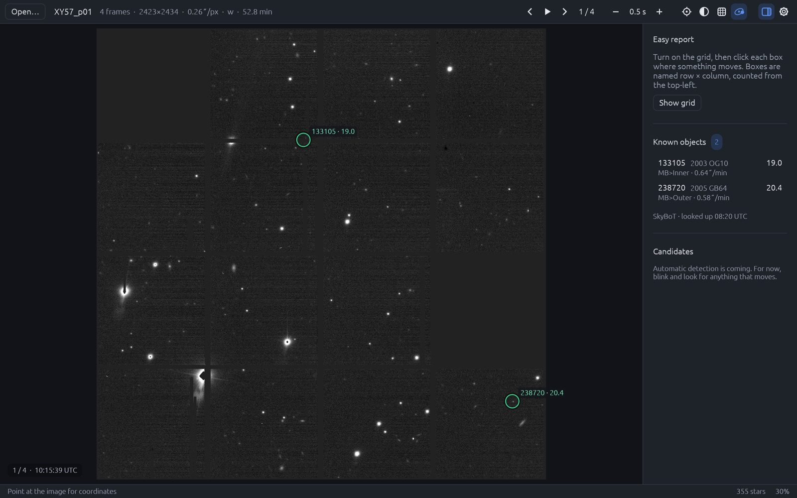
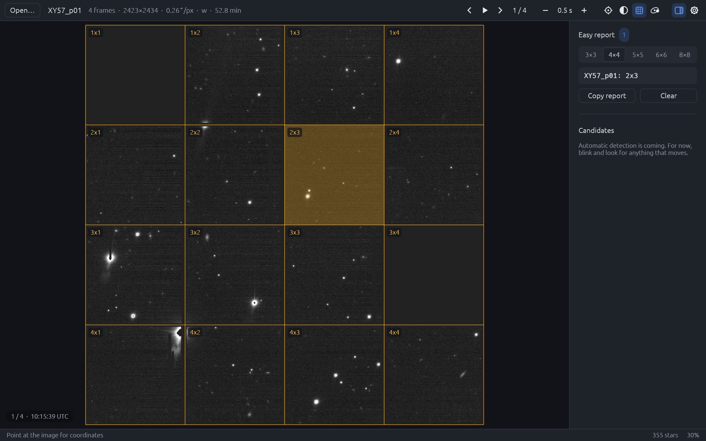

<div align="center">


# OpenCeres

**A small, fast, open-source app for asteroid searching.**
Blink your survey images, spot what moves, check known asteroids and send the report.

[](https://github.com/alidevecioglu/OpenCeres/releases/latest)
[](https://github.com/alidevecioglu/OpenCeres/actions/workflows/build.yml)
[](#license)


[**Download**](https://alidevecioglu.github.io/OpenCeres/) ·
[Releases](https://github.com/alidevecioglu/OpenCeres/releases) ·
[Report a problem](https://github.com/alidevecioglu/OpenCeres/issues)



</div>

OpenCeres is built for amateur search teams taking part in campaigns such as
those of the [International Astronomical Search Collaboration (IASC)](https://iasc.cosmosearch.org/),
where students and amateur astronomers blink sets of Pan-STARRS images to
discover new asteroids and report them to the
[Minor Planet Center](https://minorplanetcenter.net/).
It is named after Ceres, the first asteroid ever found (Piazzi, 1801).

> [!NOTE]
> **Early development.** Viewing, blinking, known objects and box reports work
> today. The image-processing core is tested on real Pan-STARRS images (FITS
> reading, star detection, sky coordinates, MPC report lines). Plate solving
> against Gaia, automatic moving-object detection and full MPC reports are in
> progress, so keep using your current software for official campaign
> measurements for now.

## Features

- **Blink** — open a folder of FITS images or the `.zip` you were sent; frames
  load in parallel and blink at any speed, with stretch, invert and zoom.
- **Known objects** — asteroids already in the field are circled with their
  name, magnitude and motion, looked up online with
  [SkyBoT](https://ssp.imcce.fr/webservices/skybot/) or offline from MPCORB.
- **Easy report** — turn on the grid (3×3 to 8×8), click every box where
  something moves and copy a ready-to-send report such as `XY57_p01: 2x3`.
  Boxes are named row × column from the top-left, like the team charts.
- **Search history** — every search is saved as you work: who searched,
  the marked boxes, notes and its status as it moves through IASC's steps
  (reported → preliminary detection → provisional designation → numbered).
  Reopen a set to continue where you left off. Point the history at a
  shared folder (OneDrive, Google Drive, a network drive) to collect a whole
  class's searches, or export them for a teacher as JSON or a spreadsheet.
- **Tiny and fast** — native Rust with no web engine: about 5 MB, starts
  instantly and uses ~0 % CPU when idle. The core library has no third-party
  dependencies.
- **Everywhere** — Apple Silicon and Intel Macs, Windows and Linux. No Wine,
  no emulators.
- **Keeps itself current** — checks for new versions and shows what's new.

<p align="center">
  
</p>

## Download

Get the latest version from the **[download page](https://alidevecioglu.github.io/OpenCeres/)**
or the [releases page](https://github.com/alidevecioglu/OpenCeres/releases/latest).

| Platform | File | First launch |
| --- | --- | --- |
| macOS 11+ (Apple Silicon and Intel) | `OpenCeres-<version>-macos.dmg` | Drag to Applications, then right-click OpenCeres → **Open** (the app is not yet notarised by Apple). |
| Windows 10 / 11 (64-bit) | `OpenCeres-<version>-windows-x86_64.zip` | Unzip and run `OpenCeres.exe`. If SmartScreen warns you, choose **More info → Run anyway**. |
| Linux (x86_64) | `OpenCeres-<version>-linux-x86_64.tar.gz` | Extract and run `./openceres-desktop` (needs OpenGL). |

Each download also contains `openceres`, a command-line tool for inspecting
FITS files and listing detected stars.

## Goals

- **Accurate.** Positions must match established software on the same images
  before anyone relies on them.
- **Tiny and fast.** A few megabytes, native, using every CPU core.
- **Easy to use.** Drop an image set in and get candidates; confirm with the
  keyboard; one click to a ready-to-send report. No configuration files.
- **Open.** Free to use, study and improve.

## Layout

```
crates/core     openceres-core: FITS, detection, WCS, time, MPC formatting (no dependencies)
crates/cli      openceres: command-line tool for checking the core on real data
crates/desktop  OpenCeres desktop app: egui (pure Rust, OpenGL), no web engine
docs/           download page (GitHub Pages)
```

## Building

Everything builds inside Docker; nothing needs to be installed on your machine
except Docker itself.

```sh
./dev check                      # core + CLI: format check, clippy, tests
./dev cargo test                 # tests only
./dev cargo build --release      # release build (Linux, in the container)
./dev shell                      # shell inside the dev container
```

Command-line tool:

```sh
./dev cargo run --release -p openceres-cli -- info  path/to/image.fits
./dev cargo run --release -p openceres-cli -- stars path/to/image.fits --limit 20
```

macOS app (built on the Mac itself, since Docker can't build macOS apps; needs
Apple's command-line tools). Rust is installed only inside
`.cache/macos-toolchain`; delete that folder to remove it.

```sh
./mac run                        # build "OpenCeres Dev.app" (about 5 MB) and open it
./mac build                      # target/macos/release/OpenCeres Dev.app
```

## Releases

GitHub Actions builds macOS (universal), Linux and Windows downloads for every
push. A release is published automatically the first time a new `version` in
`Cargo.toml` reaches `main`: bump the version, push, and the
[Releases](https://github.com/alidevecioglu/OpenCeres/releases) page gets
`v<version>` with all downloads attached.

The [download page](https://alidevecioglu.github.io/OpenCeres/) is served by
GitHub Pages from `docs/` and asks the GitHub API for the latest release when
it loads, so it never needs editing for a new version.

## Contributing

Issues and pull requests are welcome. Please run `./dev check` before opening a
pull request, and include tests for new behaviour — ideally against synthetic
images with known answers.

Do not commit real survey images or reports: survey data has its own usage
rules, and reports contain observer details. Keep them in `data/`, which is
git-ignored.

## Independence

OpenCeres is an independent project written from scratch. It is not affiliated
with, endorsed by, or derived from Astrometrica, its author, or IASC. Names of
other software and organisations are used only to describe compatibility.

## License

Licensed under either of

- Apache License, Version 2.0 ([LICENSE-APACHE](LICENSE-APACHE))
- MIT license ([LICENSE-MIT](LICENSE-MIT))

at your option. Unless you explicitly state otherwise, any contribution
intentionally submitted for inclusion in OpenCeres by you, as defined in the
Apache-2.0 license, shall be dual licensed as above, without any additional
terms or conditions.
